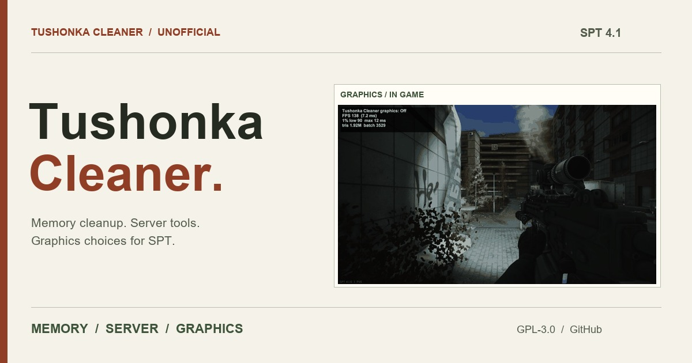

<p align="center">
  <a href="README.md"></a>
  <a href="README.en.md"></a>
</p>

<p align="center">
  <a href="https://danyhappy564-cmyk.github.io/Tushonka-Cleaner/?lang=en"></a>
</p>

<h2 align="center">📖 <a href="https://danyhappy564-cmyk.github.io/Tushonka-Cleaner/?lang=en">Measurements and comparison shots are on the project site →</a></h2>
<p align="center">Graphics level comparison · memory modes · server results · install and old-mod migration · cautions, all on one page.</p>

<p align="center">
  <a href="https://danyhappy564-cmyk.github.io/Tushonka-Cleaner/?lang=en"></a>
  <a href="https://github.com/danyhappy564-cmyk/Tushonka-Cleaner/releases/latest"></a>
</p>

---

### ⚠️ IMPORTANT NOTICE / DISCLAIMER

- **Original Author:** CactusPie
  - **Original Repository:** SPT-RamCleanerInterval
  - **Original Link:** https://github.com/CactusPie/SPT-RamCleanerInterval
  - **License:** GPL-3.0
- **Original Author:** matsix
  - **Original Repository:** SPTVRAMCleaner
  - **Original Link:** https://github.com/matsixx/SPTVRAMCleaner
  - **License:** GPL-3.0
- **Original Author:** EchoStarz
  - **Original Repository:** CompoundingPerf
  - **Original Link:** https://forge.sp-tarkov.com/mod/2415/compoundingperf
  - **License:** MIT
- **Idea Source:** Tyrian (Xenoxia8953)
  - **Original Repository:** Tyrian-DeClutterer
  - **Original Link:** https://github.com/Xenoxia8953/Tyrian-DeClutterer
  - **Note:** The idea of hiding small decorations came from this mod. No code was used.
- **License of This Build:** GPL-3.0. See [NOTICE.md](NOTICE.md) and [LICENSE](LICENSE).
- **This Port By:** R_F (danyhappy564-cmyk) — unofficial, AI-assisted port. Not affiliated with or endorsed by the original authors.

1. **Reflection & Take-Downs:** I deeply reflect on the ECOT incident. As an AI-assisted "vibe coder," I will immediately delete files if the original authors ask.
2. **No Re-Distribution:** These ported builds are unverified, temporary fixes. Please do NOT re-upload or share them anywhere else.
3. **Do Not Pester Original Authors:** Never report bugs or pester original modders regarding issues from my unofficial ports.
4. **Full Credit & Respect:** I will always credit original creators on GitHub and prioritize their decisions above all else.
5. **Support Original Creators:** Instead of using my ports, please visit the original authors' Forge pages to leave kind words or tips.

---

## Changelog

The full changelog (4 entries) is in the [`changelog/`](changelog/) folder, 10 per file (higher number = newer, latest: [`CHANGELOG-001.md`](changelog/CHANGELOG-001.md)). Per-release summaries: [Releases](../../releases).

## Features

- Preserves the five RAM cleaner modes, custom settings, web pages, reports and diagnostics.
- From CompoundingPerf only the features with a measured or confirmed effect remain: S9 (response compression), S12 (bot gear bug fix), C1 (pause hidden menu videos) and C2 (landed airdrop physics). 1.1.0 removed what had no effect or carried risk; per-feature numbers are at the top of the two documents below.
- Old mods (RAM Cleaner, CompoundingPerf, DeClutter) are moved to `Tushonka-Cleaner-OldMods` in the game folder when the server starts. Nothing is deleted, so you can restore them. Overlapping features stay off on that first run, so restart the server once. Matching legacy RAM configuration sections and keys are imported once when the new cfg does not exist.
- **Do not use this mod together with Smoothie.** Both change the same game systems, which can cause overlapping effects or errors. If both are installed, a warning appears in the server console and on the menu screen. Smoothie files are left untouched.
- The graphics feature hides small decorations that do not affect play and adjusts graphics values. It is off by default. Hide a bit more is recommended because it changes little, and Hide more clutter is the level that raises FPS by a large amount. It was written from scratch without other mods' code; the supporting material is in `tests/SceneCleanup/`.

The web settings page looks the same with the game closed and open, and settings can be changed with the game closed.

Archived feature descriptions: [memory](docs/ram-cleaner.md), [server](docs/server-optimizations.md). Their legacy installation and build paths do not apply to this package.

## Measured results

**From 1.1.0.** Measured on an RTX 4080 at 2560x1440 with no bots on SPT 4.1.6, at 3 spots per map with 3 runs of 4 seconds. Values are FPS change compared with Off. Results vary by PC and map state.

| Map | Light touch | A bit more | More (Off in the same raid) | More (Off in the other raid) | More: FPS per spot |
|---|---|---|---|---|---|
| Streets | -2% ~ -1% | -4% ~ +4% | +9% ~ +13% | +4% ~ +7% | 157 / 177 / 136 |
| Customs | -6% ~ 0% | 0% | +9% ~ +22% | +1% ~ +14% | 239 / 221 / 227 |
| Factory | 0% ~ +4% | 0% ~ +5% | +2% ~ +7% | 0% ~ +5% | 245 / 274 / 246 |
| Interchange | -3% ~ 0% | -1% ~ 0% | +3% ~ +9% | +2% ~ +4% | 225 / 232 / 233 |
| Labs | 0% ~ +19% | -3% ~ +17% | +16% ~ +23% | +16% ~ +35% | 265 / 252 / 259 |
| Labyrinth | 0% | 0% ~ +1% | 0% ~ +1% | 0% ~ +3% | 245 / 250 / 242 |
| Lighthouse | -3% ~ -1% | -3% ~ -1% | +22% ~ +25% | +15% ~ +16% | 243 / 242 / 236 |
| Reserve | 0% | -1% ~ 0% | +18% ~ +23% | +19% ~ +24% | 215 / 260 / 219 |
| Ground Zero | -1% ~ 0% | 0% ~ +2% | +5% ~ +14% | +5% ~ +13% | 224 / 212 / 218 |
| Shoreline | -6% ~ 0% | 0% | +22% ~ +34% | +21% ~ +28% | 235 / 224 / 209 |
| Woods | -1% ~ +1% | 0% | +21% ~ +27% | +12% ~ +18% | 210 / 230 / 220 |

- Off itself differed between raids, mostly by up to 9% and by 16% at one Labs spot, so both baselines are shown. On Customs, the raid measuring Off gained triangles, so the other-raid value reads low.
- Only Hide more clutter raises FPS by a large amount. Hide a bit more made almost no difference without bots, and firefights were not measured.
- Hide more clutter does not draw grass. Bot vision does not change.
- The automatic hole check flagged 5 of 792 shots. All were inspected by eye and were grass removal, not holes.
- The frame cost of the memory modes stayed within measurement noise (±0.5 ms, measured on 1.0.0).
- Post-raid GC: managed memory 4.6-5.3 GB → about 3 GB, about 0.3 s of work.
- Response compression (S9): nine key responses took 636 ms with the original setting and 440 ms with Balanced at the same 4.9 MB. Fast is 351 ms at 7.8 MB.
- GIFs, comparison images and the per-feature audit are on the [project site](https://danyhappy564-cmyk.github.io/Tushonka-Cleaner/).

## Build and tests

Requires the .NET 10 SDK and game reference assemblies. Builds never deploy to the game folder.

```powershell
dotnet build Tushonka.Cleaner.sln -c Release -p:DeployPlugin=false -p:SkipDeploy=true
dotnet test tests/Tushonka.Cleaner.Tests/Tushonka.Cleaner.Tests.csproj -c Release -p:SkipPackage=true -p:DeployPlugin=false -p:SkipDeploy=true
```

Use `-p:SptRoot="path"` to override the game directory. Release builds are configured to create `release/Tushonka-Cleaner-1.1.0.zip` containing:

```text
BepInEx/plugins/Tushonka-Cleaner/Tushonka.Cleaner.dll
BepInEx/plugins/Tushonka-Cleaner/scene-rules.json
BepInEx/plugins/Tushonka-Cleaner/tushonka-exclude.example.txt
SPT_Runtime/user/mods/Tushonka-Cleaner/Tushonka.Cleaner.Server.dll
SPT_Runtime/user/mods/Tushonka-Cleaner/config.json
LICENSE
NOTICE.md
```

Client configuration: `BepInEx/config/com.zzap.tushonka.cleaner.cfg`. Live web page: `http://127.0.0.1:6977/`. Server pages: `/tushonka-cleaner/` and `/tushonka-cleaner/performance`.

