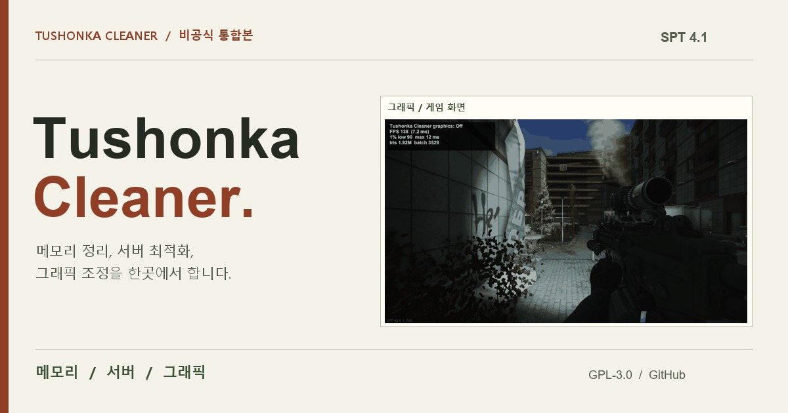

<p align="center">
  <a href="README.md"></a>
  <a href="README.en.md"></a>
</p>

<p align="center">
  <a href="https://danyhappy564-cmyk.github.io/Tushonka-Cleaner/"></a>
</p>

<h2 align="center">📖 <a href="https://danyhappy564-cmyk.github.io/Tushonka-Cleaner/">측정값과 비교 사진은 소개 사이트에 있습니다 →</a></h2>
<p align="center">그래픽 단계 비교 · 메모리 모드 · 서버 측정 · 설치와 옛 모드 이동 · 주의사항을 한 페이지에 정리했습니다.</p>

<p align="center">
  <a href="https://danyhappy564-cmyk.github.io/Tushonka-Cleaner/"></a>
  <a href="https://github.com/danyhappy564-cmyk/Tushonka-Cleaner/releases/latest"></a>
</p>

---

### ⚠️ IMPORTANT NOTICE / DISCLAIMER

- **Original Author:** CactusPie
  - **Original Repository:** SPT-RamCleanerInterval
  - **Original Link:** https://github.com/CactusPie/SPT-RamCleanerInterval
  - **License:** GPL-3.0
- **Original Author:** matsix
  - **Original Repository:** SPTVRAMCleaner
  - **Original Link:** https://github.com/matsixx/SPTVRAMCleaner
  - **License:** GPL-3.0
- **Original Author:** EchoStarz
  - **Original Repository:** CompoundingPerf
  - **Original Link:** https://forge.sp-tarkov.com/mod/2415/compoundingperf
  - **License:** MIT
- **Idea Source:** Tyrian (Xenoxia8953)
  - **Original Repository:** Tyrian-DeClutterer
  - **Original Link:** https://github.com/Xenoxia8953/Tyrian-DeClutterer
  - **Note:** 작은 장식을 가린다는 착상을 참고했습니다. 코드는 사용하지 않았습니다.
- **License of This Build:** GPL-3.0. See [NOTICE.md](NOTICE.md) and [LICENSE](LICENSE).
- **This Port By:** R_F (danyhappy564-cmyk) — unofficial, AI-assisted port. Not affiliated with or endorsed by the original authors.

1. **Reflection & Take-Downs:** I deeply reflect on the ECOT incident. As an AI-assisted "vibe coder," I will immediately delete files if the original authors ask.
2. **No Re-Distribution:** These ported builds are unverified, temporary fixes. Please do NOT re-upload or share them anywhere else.
3. **Do Not Pester Original Authors:** Never report bugs or pester original modders regarding issues from my unofficial ports.
4. **Full Credit & Respect:** I will always credit original creators on GitHub and prioritize their decisions above all else.
5. **Support Original Creators:** Instead of using my ports, please visit the original authors' Forge pages to leave kind words or tips.

---

## 변경 이력

전체 변경 이력 2개는 [`changelog/`](changelog/) 폴더에 10개씩 나눠 있습니다 (번호가 클수록 최신, 최신 파일: [`CHANGELOG-001.md`](changelog/CHANGELOG-001.md)). 릴리즈별 요약은 [Releases](../../releases).

## 포함 기능

- RAM 클리너의 자동 정리·간단 확인·집중 분석·누수 추적·꺼짐 모드와 직접 설정, 웹·보고서·진단 기능을 유지합니다.
- CompoundingPerf의 서버 기능과 클라이언트 C1(숨겨진 메뉴 영상 일시정지)·C2(착지한 에어드랍 물리 정리)를 유지합니다.
- 이전 모드(RAM Cleaner, CompoundingPerf, DeClutter)는 서버를 켤 때 게임 폴더의 `Tushonka-Cleaner-OldMods`로 자동으로 옮깁니다. 지우지 않으므로 필요하면 되돌릴 수 있습니다. 옮긴 첫 실행에서는 겹치는 기능이 멈추므로 서버를 한 번 다시 켜야 합니다. 새 cfg가 없을 때 구형 RAM cfg의 같은 절·키를 한 번 이전합니다.
- **Smoothie 모드와 함께 쓰지 마십시오.** 같은 게임 기능을 건드려 효과가 겹치거나 오류가 날 수 있습니다. 함께 설치되어 있으면 서버 콘솔과 메뉴 화면에 경고를 표시합니다. Smoothie 파일은 건드리지 않습니다.
- 그래픽 기능은 그래픽 조정으로 프레임을 올리고, 게임 진행과 무관한 작은 장식을 가립니다. 기본값은 꺼짐이고 권장은 조금 더 가림입니다. 다른 모드의 코드 없이 새로 작성했으며 근거 자료는 `tests/SceneCleanup/`에 있습니다.

통합 전의 상세 기능 설명은 [메모리 기능](docs/ram-cleaner.md)과 [서버 기능](docs/server-optimizations.md)에 보존했습니다. 그 문서의 구형 설치·빌드 경로는 현재 배포 경로로 사용하지 않습니다.

## 측정 결과

RTX 4080, 2560x1440, 봇 없음, SPT 4.1.6에서 쟀습니다. 3곳을 4초씩 3회 잰 평균입니다. PC와 맵 상태에 따라 달라집니다.

| 그래픽 단계 | 스트리트 (ms) | 등대 (ms) | 화면 변화 |
|---|---|---|---|
| 끔 | 8.4 / 7.8 / 6.8 | 5.7 / 5.2 / 5.6 | 없음 |
| 간단하게만 가림 | 8.4 / 7.9 / 6.9 | 5.7 / 5.2 / 5.6 | 먼 장식만 사라집니다. 프레임은 늘지 않습니다. |
| 조금 더 가림 (권장) | 7.1 / 6.7 / 6.0 | 5.1 / 4.6 / 5.3 | 먼 모델과 그림자가 단순해집니다. |
| 많이 가림 | 5.4 / 5.2 / 4.7 | 5.0 / 4.7 / 5.1 | 그림자가 꺼져 어두운 곳이 밝아지고, 가까운 벽도 거칠어집니다. |

- 프레임 향상은 그래픽 조정에서 나옵니다. 스트리트에서 규칙에 맞는 장식 15,696개를 모두 꺼도 프레임은 변하지 않았습니다.
- 메모리 모드의 프레임 부담은 측정 오차(±0.5ms) 안이었습니다.
- 자동 정리: 메모리가 1.5GB 늘면 동작합니다. 시험에서 4.49GB를 3.41GB로 0.8초에 줄였고, 95ms 끊김이 한 번 있었습니다.
- 서버 `/client/items` 응답: 끔 489ms(3.6MB), 균형 305ms(3.7MB), 권장 265ms(5.9MB).

## 빌드와 테스트

게임 참조 DLL이 있는 SPT 경로와 .NET 10 SDK가 필요합니다. 빌드는 게임 폴더로 복사하지 않습니다.

```powershell
dotnet build Tushonka.Cleaner.sln -c Release -p:DeployPlugin=false -p:SkipDeploy=true
dotnet test tests/Tushonka.Cleaner.Tests/Tushonka.Cleaner.Tests.csproj -c Release -p:SkipPackage=true -p:DeployPlugin=false -p:SkipDeploy=true
```

다른 게임 경로는 `-p:SptRoot="경로"`로 지정합니다. Release 빌드는 `release/Tushonka-Cleaner-1.0.0.zip`을 생성하도록 구성되어 있습니다.

```text
BepInEx/plugins/Tushonka-Cleaner/Tushonka.Cleaner.dll
BepInEx/plugins/Tushonka-Cleaner/scene-rules.json
BepInEx/plugins/Tushonka-Cleaner/tushonka-exclude.example.txt
SPT_Runtime/user/mods/Tushonka-Cleaner/Tushonka.Cleaner.Server.dll
SPT_Runtime/user/mods/Tushonka-Cleaner/config.json
LICENSE
NOTICE.md
```

설정 파일은 `BepInEx/config/com.zzap.tushonka.cleaner.cfg`입니다. 웹 페이지는 기존처럼 게임 실행 중 `http://127.0.0.1:6977/`에서 열립니다. 서버 웹 패널 주소는 `/tushonka-cleaner/`, 서버 최적화 전용 화면은 `/tushonka-cleaner/performance`입니다.

